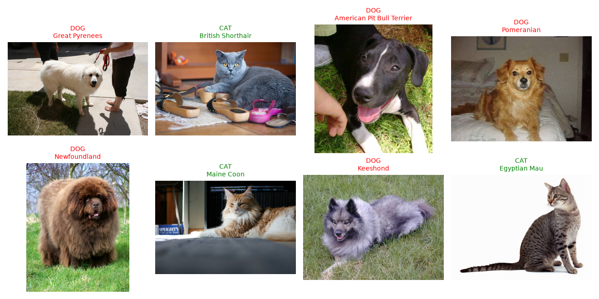
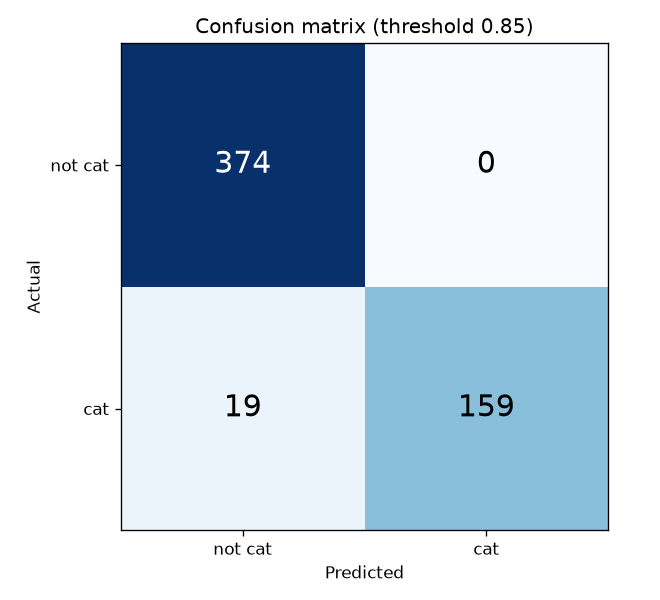
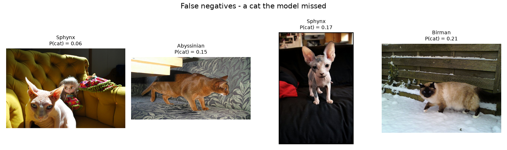
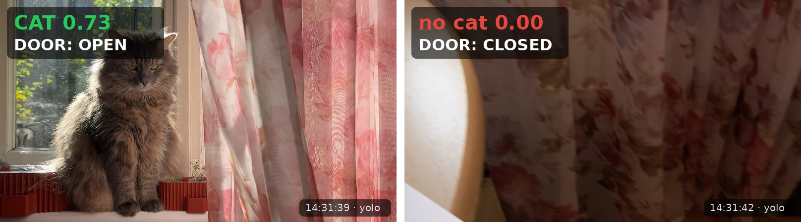

# 🐾 Paw Pass

**Немає лап — немає перепустки.**

[](README.md)
[](README.uk.md)

[](https://www.python.org/)
[](https://pytorch.org/)
[](https://opencv.org/)
[](https://docs.ultralytics.com/)

---

Вебкамера стежить за входом. Коли бачить кота, двері відчиняються, а коли
кіт пішов, зачиняються знову. Замок поки симульований за інтерфейсом
`DoorController`, і його можна замінити справжнім реле чи сервоприводом.

## Головне

- **Поріг обрано на validation, test оцінено один раз.** За числами кращим
  був 0.70; 0.85 залишено свідомо, і причина [записана](#поріг-обрано-на-validation).
- **Error analysis знайшов корінь проблеми.** Пропущені коти-сфінкси і дряпка,
  яку прийняли за кота, мають [одну причину — опору на текстуру шерсті](#що-показують-помилки).
- **Логіка дверей, що витримує справжню камеру.** Hysteresis, серії кадрів і
  мінімальний час відчинення — після [бага зі смиканням дверей](#робота-в-реальному-часі), який тепер відтворює тест.
- **Два взаємозамінні детектори.** Натренований тут класифікатор і готовий
  YOLO мають один інтерфейс і перемикаються прапорцем.

## Швидкий старт

```bash
python -m venv venv && source venv/bin/activate
pip install -r requirements.txt

python main.py train                     # завантажує датасет і тренує модель
python main.py camera --model mobilenet  # або --model yolo
```

`python main.py` показує всі команди. Вийти з камери — `Q` / `Esc` або
`Ctrl+C`. На macOS терміналу потрібен доступ до камери: System Settings →
Privacy & Security → Camera.

## Як це працює

```
НАВЧАННЯ (один раз)                      РОБОТА (кожен кадр)

Oxford-IIIT Pet                          Камера → кадр OpenCV
   ↓ resize, normalize, augment             ↓ resize, normalize
   ↓ поділ 70 / 15 / 15                     ↓
MobileNetV2, навчена нова голова ──────► модель → P(cat)
   ↓                                        ↓ hysteresis + серії кадрів
поріг обрано на validation                  ↓
оцінка на test, один раз                 DoorController → OPEN / CLOSED
```

Задача — бінарна класифікація: на вхід RGB-зображення `[3, 224, 224]`, на
виході два logits, які softmax перетворює на `P(cat)`.

## Датасет

[Oxford-IIIT Pet](https://www.robots.ox.ac.uk/~vgg/data/pets/): 3 680
зображень 37 порід. 12 котячих порід позначено `1`, 25 собачих — `0`.

| | Зображень | Частка |
|---|---|---|
| не кіт | 2 492 | 67.7% |
| кіт | 1 188 | 32.3% |

Відповідь «завжди не кіт» вже дає accuracy 0.677, тож це baseline, а
precision і recall тут важливіші за accuracy.

Поділ 70 / 15 / 15, стратифікований за міткою, з фіксованим seed:
2 576 / 552 / 552.



## Модель

MobileNetV2, попередньо навчена на ImageNet. Згорткові шари заморожені,
останній шар замінено на `Linear(1280 → 2)`, тож навчається лише
**2 562 з 2.2 млн** параметрів. На 3 680 зображеннях модель збігається за
п'ять epochs.

| | |
|---|---|
| Вхід | Resize 224×224, нормалізація mean / std ImageNet |
| Augmentation (лише train) | Горизонтальне віддзеркалення, поворот ±10°, зміна яскравості |
| Навчання | CrossEntropy, Adam lr 1e-3, batch 32, 5 epochs |
| Accuracy після 5 epochs | train 0.972, val 0.982 — overfitting немає |

## Результати

### Поріг обрано на validation

False positive відчиняє двері чужому, тому precision на першому місці.

```
   thr  Precision   Recall    FP    FN
  0.50      0.994    0.938     1    11
  0.70      1.000    0.888     0    20
  0.85      1.000    0.854     0    26   <- обрано
  0.95      1.000    0.792     0    37
```

На папері перемагає 0.70: так само нуль false positives і на шість котів
більше впущено. 0.85 залишено свідомо. Усі «не коти» в даних — собаки, тож
нуль false positives тут нічого не каже про килими чи дряпки, а жива камера
саме їх і приймала за кота. Додатковий запас закриває цю прогалину, доки її
не закриють дані.

### Фінальна оцінка на test (552 зображення, поріг 0.85, один запуск)

| Accuracy | Precision | Recall | F1 |
|---|---|---|---|
| **0.966** | **1.000** | **0.893** | **0.944** |



Жоден «не кіт» не відчинив би двері; 19 зі 178 котів довелося б почекати.

### Що показують помилки



Серед найвпевненіших пропусків — безшерсті коти-сфінкси і коти з темною
або затіненою мордою. Разом з дряпкою, яку камера прийняла за кота, це
вказує на одну причину: модель надто покладається на текстуру шерсті.

## Робота в реальному часі



*Дві послідовні події з `logs/events.csv`: кадр, який записала камера, з нанесеним поверх рішенням.*

Між оцінкою кадру і замком стоять три шари:

| Шар | Налаштування | Від чого захищає |
|---|---|---|
| Hysteresis | відчинити ≥ 0.50, лишити відчиненими ≥ 0.30 (YOLO) | Смикання, коли confidence коливається біля одного порогу |
| Серії кадрів | 5 кадрів поспіль, щоб відчинити чи зачинити | Один розмитий кадр, що рухає двері |
| Мінімальний час відчинення | 3 с | Двері зачиняються, щойно кіт вийшов з кадру |

Hysteresis додано після живого запуску, де двері перемкнулись десять разів
за кілька секунд; `tests/test_debounce.py` відтворює ту саму послідовність.

Два взаємозамінні детектори:

| | `mobilenet` | `yolo` |
|---|---|---|
| Підхід | Класифікація всього кадру | Object detection, клас COCO 15 |
| Натреновано тут | Так | Ні, готова модель |
| Пороги (відчинити / тримати) | 0.85 / 0.60 | 0.50 / 0.30 |

YOLO знаходить саму тварину, а не оцінює кадр цілком, тому на справжніх
дверях це сильніший вибір.

Кожна зміна стану дверей записується в `logs/events.csv` разом з кадром,
що її спричинив. Кадри хибних відчинень — готові hard negatives.

## Структура проєкту

```
main.py              точка входу: python main.py <команда>
src/
├── config.py        шляхи і всі налаштовувані числа
├── device.py        MPS / CUDA / CPU
├── ml/              потрібне і навчанню, і роботі камери
│   ├── preprocessing.py
│   ├── model.py
│   └── inference.py
├── training/        запускається один раз
│   ├── data.py  eda.py  train.py  evaluate.py  error_analysis.py
└── runtime/         працює на кожному кадрі
    ├── detectors.py  debounce.py  door_controller.py
    ├── event_log.py  camera.py
tests/               19 тестів логіки дверей, камера не потрібна
```

Імпорти йдуть в один бік: `training/` і `runtime/` використовують `ml/`, але
не одне одного. Raspberry Pi потрібні лише `ml/`, `runtime/` і натреновані ваги.

| Команда | Що робить |
|---|---|
| `python main.py eda` | Огляд датасету |
| `python main.py train` | Навчання → `models/cat_detector.pth` |
| `python main.py evaluate` | Підбір порогу на val, фінальна оцінка на test |
| `python main.py errors` | Зберегти приклади FP / FN з validation |
| `python main.py camera` | Запустити двері (`--model`, `--headless`, `--no-log`) |
| `pytest tests/ -q` | Запустити тести |

## Обмеження і наступні кроки

| Обмеження | Наступний крок |
|---|---|
| «Не кіт» — лише собаки; килими й дряпки обманюють модель | Додати hard negatives з `logs/frames/` |
| Модель спирається на шерсть, пропускає сфінксів | Більше безшерстих котів, сильніша augmentation яскравості |
| Фото тварин крупним планом, а не з камери біля дверей | Зібрати кадри з реального положення камери |
| Класифікація не знає, де саме кіт | Використати YOLO для розгортання |
| Заходить будь-який кіт, а не лише мій | Re-identification: порівнювати embedding з еталонними фото одного кота |
| Немає нічних кадрів | Інфрачервона камера і нічні дані для навчання |
